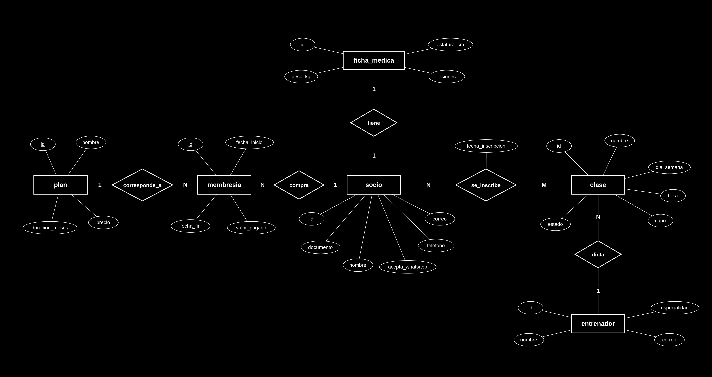
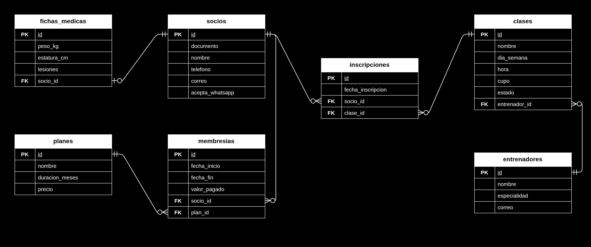

# Gimnasio Cuerpo Activo

Base de datos en PostgreSQL para el gimnasio Cuerpo Activo, que llevaba los socios en cuadernos y en un grupo de WhatsApp. Es el taller del módulo de Bases de Datos Relacionales de Generation Colombia, con sus cuatro fases: diseñar, construir, preguntar y conectar.

Jesús David López Ahumada

## El modelo





Son siete tablas y seis claves foráneas. Lo que más pesa en el diseño:

- Un socio llega al plan a través de la membresía, no directo. Cada renovación es una membresía nueva y guarda lo que el socio pagó de verdad (`valor_pagado`), porque el precio del plan cambia y a veces hay descuento.
- `fichas_medicas.socio_id` es UNIQUE: un socio tiene una sola ficha.
- `inscripciones` es la tabla intermedia entre socios y clases, y no deja inscribir dos veces a la misma persona en la misma clase.
- Las clases no se borran, se suspenden (`estado`). Por eso `inscripciones.clase_id` protege al padre, mientras que la ficha médica y las inscripciones se van en cascada si se borra un socio.

Los diagramas de la fase 1, antes de agregar `valor_pagado`, `acepta_whatsapp` y `estado`, están en `diagramas/fase1/`. El archivo editable es `diagramas/gimnasio.drawio`.

## Cómo correrlo

Desde la base `postgres`:

```sql
CREATE DATABASE gimnasio_cuerpo_activo;
```

Después, conectado a `gimnasio_cuerpo_activo`, los 18 archivos en orden. Con psql:

```bash
for f in [0-9]*.sql; do psql -d gimnasio_cuerpo_activo -v ON_ERROR_STOP=1 -f "$f"; done
```

Cada archivo se corre una sola vez, porque varios cambian la estructura (`ALTER TABLE`, `CREATE VIEW`). Sobre una base vacía los 18 pasan sin errores.

| Archivo | Parte | Qué hace |
|---|---|---|
| `01_estructura.sql` | D | tablas |
| `02_datos.sql` | E | datos iniciales |
| `03_consultas.sql` | F | SELECT con WHERE |
| `04_cambios.sql`, `05_actualizaciones.sql` | G | columna `estado`, UPDATE y DELETE |
| `06_tipos.sql` | H | `valor_pagado` y `acepta_whatsapp` |
| `07_restricciones.sql` | I | CHECK y UNIQUE con nombre |
| `08_claves_foraneas.sql` | J | ON DELETE CASCADE donde aplica |
| `09_mas_datos.sql`, `10_consultas.sql` | K | más datos y filtros |
| `11_reportes.sql` | L | COUNT, SUM, MIN, MAX, AVG |
| `12_por_grupos.sql` | M | GROUP BY y HAVING |
| `13_joins.sql` | O | JOIN |
| `14_sin_pareja.sql` | P | LEFT JOIN con IS NULL |
| `15_horarios.sql` | Q | pasar por la tabla intermedia |
| `16_informe.sql` | R | JOIN con GROUP BY, la clase de Pilates |
| `17_subconsultas.sql` | S | IN, NOT IN y el promedio |
| `18_vistas.sql` | T | vistas para recepción |

## Lo que recepción consulta cada mañana

```sql
SELECT * FROM socios_vencidos;
SELECT * FROM ocupacion_clases;
```

La primera mira la última membresía de cada socio, así que alguien que renovó no sale como vencido aunque tenga una membresía vieja ya terminada. La segunda cuenta los inscritos de las clases activas y deja en 0 las que todavía no tienen a nadie, como Pilates.

Las fechas de los datos están pensadas para noviembre de 2026. Las consultas de vencidos usan `CURRENT_DATE`, así que si se corren más adelante el resultado cambia.
